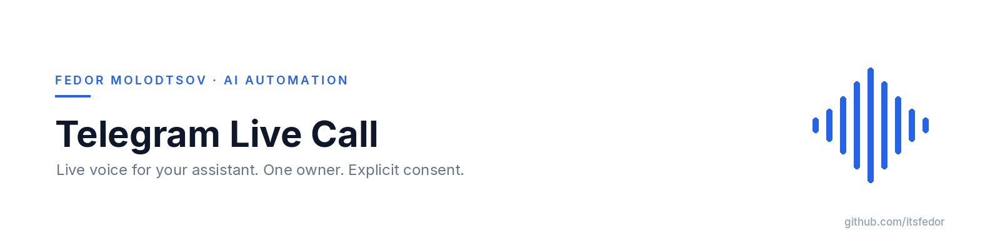
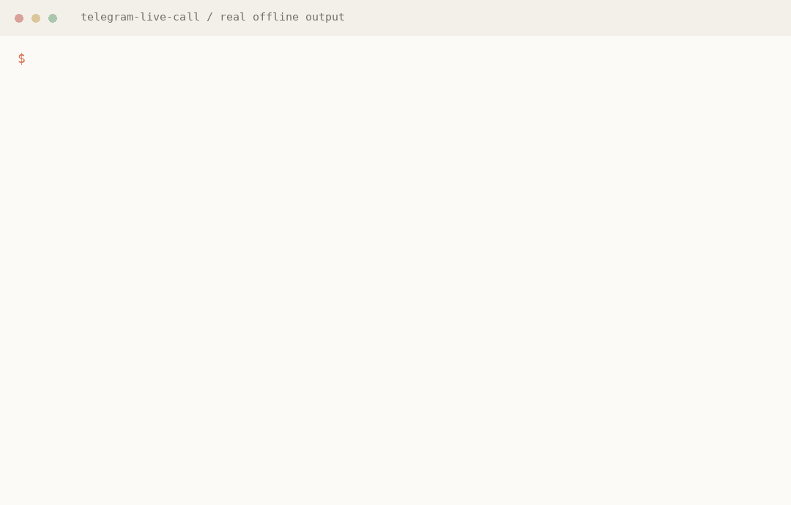

<picture>
  <source media="(prefers-color-scheme: dark)" srcset="assets/banner-dark.png">
  
</picture>
<p align="center"><sub><b>Fedor Molodtsov</b> — AI automation engineer · github.com/itsfedor</sub></p>

# Telegram Live Call


A small bridge that lets an AI assistant call its owner in Telegram, listen to live speech and answer by voice. It uses a separate Telegram user account, an explicit owner allowlist and a hard call timeout. This is an experimental voice pipeline, not an autodialer or a replacement for your agent runtime.



*Real CLI output and offline tests. This is not a recording of a Telegram call; no private conversation is shown.*

## Why it exists

A long task review is easier to settle in a short conversation than by replying to a wall of checkboxes. This project turns that interaction into a normal Telegram call, without moving the owner to a new app.

```text
Owner's Telegram audio → PyTgCalls / NTgCalls → Deepgram streaming STT
                                                  ↓
                                        OpenRouter chat model
                                                  ↓
Owner's Telegram audio ← paced PCM16 frames ← ElevenLabs TTS
```

## Commands

| Command | Effect |
| --- | --- |
| `check` | Verify the configured assistant and owner. Does not call or synthesize. |
| `login` | Human-run interactive login for a dedicated Telethon session. |
| `prepare` | Generate the greeting before the call; uses TTS credits. |
| `call --confirm` | Place one time-limited call to the configured owner. |
| `call --confirm --save-transcript` | Also opt in to local transcript storage. |

There is no arbitrary per-call destination, background service, scheduled calling, automatic redial or incoming-call answering. The default 60-second limit includes ringing; the maximum configurable limit is 300 seconds.

## Verified

- The original private prototype completed a real two-way Telegram call on Linux arm64 / Python 3.13.
- That run produced three recognized user turns and three spoken model replies. Observed response preparation was about 3–6 seconds after a finalized transcript; this is one run, not a latency guarantee.
- The published package separates configuration, login/session handling, call policy, audio framing and the speech pipeline. Its packaging and automated tests are checked independently; a new operator still needs a consented real-call test.
- The public package has 136 offline tests covering owner/source validation, session locking, CLI consent, framing, provider serialization, clean ASR disconnects and interruption cleanup.
- No private conversation audio, transcripts, account IDs, credentials or personal prompt is included here. Demo assets replay only actual offline test/CLI output, not a fabricated call.

## Quick start

Requirements: Linux or macOS, Python 3.13+, Git, FFmpeg on PATH, two Telegram user accounts (owner + assistant), and your own Deepgram, ElevenLabs and OpenRouter credentials. Provider usage can cost money. Linux arm64 is the live-tested platform; others need their own verification.

```bash
git clone https://github.com/itsfedor/telegram-live-call.git
cd telegram-live-call
uv venv --python 3.13
uv pip install -e '.[test]'
cp .env.example .env
chmod 600 .env
```

Fill `.env` locally. Telegram API credentials come from [my.telegram.org/apps](https://my.telegram.org/apps), not BotFather. Configure distinct `CALL_OWNER_ID` and `CALL_SOURCE_ID` values and an explicit `ELEVENLABS_VOICE_ID` available on your account. Use a separate assistant account and a new dedicated session, not an active session copied from another app or host.

An explicit `--env-file` takes precedence over ambient environment variables. Optional `STATE_DIR`, `SESSION_PATH`, `CALL_GREETING` and `CONTEXT_FILE` control local state, the dedicated session, greeting and prompt. If the assistant has never messaged the owner, message the owner once or set `CALL_OWNER_USERNAME` to help resolve the account; the resolved ID is still checked against `CALL_OWNER_ID`.

```bash
source .venv/bin/activate
telegram-live-call --env-file .env login
telegram-live-call --env-file .env check
telegram-live-call --env-file .env prepare
# Warn the owner in chat, then place ONE consented test call:
telegram-live-call --env-file .env call --confirm
```

`login` is an interactive operation performed by the human in their own terminal. Never paste login codes, passwords or session strings into an agent chat. `CALL_MAX_SECONDS=60` is a diagnostic default; agree on a longer limit before a working review.

Without uv: `python3.13 -m venv .venv`, activate it, then `python -m pip install -e '.[test]'`.

## Install the agent skill

The public skill contains generic operating instructions, no personal assistant configuration.

```bash
npx skills add itsfedor/telegram-live-call -g -y --copy
# Or select your agents explicitly:
npx skills add itsfedor/telegram-live-call -g -a hermes-agent -a claude-code -a codex -y
# Update installed skills:
npx skills update
```

The skill's `scripts/setup.sh` installs the Python CLI. Installing the skill alone does not log in or authorize a call. Without Node, clone this repo and copy `skills/telegram-live-call/` into your agent's skill directory. For a named Hermes profile, use that profile's native skill installation or copy into its own skills directory; `npx skills` is not profile-aware.

## Context, privacy and limits

- The voice model has **no Notion/calendar/tools** and does not inherit your agent's full session. It can discuss proposed decisions; it cannot apply them.
- An optional `CONTEXT_FILE` supplies a prompt. Only include information you consent to sending to the model provider.
- Audio is processed by Deepgram, speech text by ElevenLabs, and context/conversation by OpenRouter and its model provider.
- No transcript is persisted by default. `--save-transcript` explicitly enables local storage. Session files and any stored transcripts must stay private.
- Streaming transcription can mishear names or switch languages. Confirm uncertain names, amounts and decisions.
- Interruption support is implemented; subjective barge-in quality depends on network and providers. No reconnect is implemented.
- Voice/model availability and PCM output permissions depend on your provider account. A configured key is not evidence of a working call; run your own test.
- Use only with the owner's explicit consent. Follow Telegram's terms and local law.

See [SECURITY.md](SECURITY.md) and [.env.example](.env.example).

## Development

```bash
uv pip install -e '.[test]'
python -m pytest tests -q
```

Tests use local fake provider endpoints and synthetic account IDs. They must never dial Telegram or spend provider credits. No GitHub Actions workflow is required; build/test locally.

## License

MIT for this project's code. PyTgCalls, NTgCalls and other dependencies retain their own licenses; they are installed separately, not vendored. See [LICENSE](LICENSE).
